<div align="center">


# Disco Diffusion Nano

**Disco Diffusion as a local Windows app, rebuilt for 8GB graphics cards.**

[](https://ko-fi.com/neuromindart)
[](https://neuromind.art)
[](LICENSE)

</div>

Nano keeps Disco Diffusion's painterly, CLIP-guided look and drops the notebook. It runs as a local
web app with live previews and a gallery, and its memory savings fit full-size renders on an
RTX 3070.

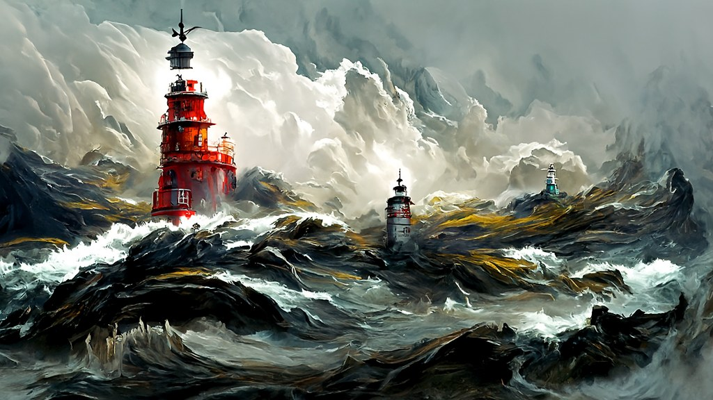

<p>
  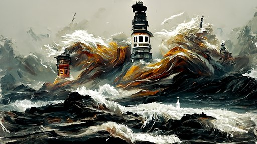
  
</p>

Each picture is 1024×576 at 200 steps with the default settings, and took about 6 minutes on an
RTX 3070 8GB.

## Features

- Horizontal or vertical renders with one click, up to 1280 on the long side
- Looks that set how the prompt shapes the picture
- Drop a start image, a video, or guide images straight onto the page
- Render on another PC: share the PC with the GPU and use Nano from any browser on your network
- One switch between plain names, such as Denoise %, and Disco Diffusion's official names
- Handoff: a Stable Diffusion 1.5 or SDXL checkpoint you already have lays out the scene, and Disco paints it
- Image prompts: a set of images guides the render alongside the text, like an embedding with no training
- VRAM, RAM and disk bars that show what Disco uses next to the rest of the PC. Offloading to RAM
  turns on by itself when a render needs it
- Settings that can't work together are grayed out, with the reason when you hover
- A gallery sorted into folders. Drag an image onto a folder to move it
- Schedules that change over a render, such as the cutout counts, are edited by dragging. Any
  changed setting resets to its default with one click
- Tiles: images far larger than the frame, with no joins, from a start image or text alone
- Animation: 2D and 3D camera moves or a repainted video, with keyframes, a curve editor and prompt
  changes at any frame. Saves MP4, WebP and GIF
- Start from any image, with Match, Fit, Fill and Crop sizing
- Send any finished render back in as a start image
- Right-click any image to open, copy, save, upscale or reuse it
- Exact repeat, so the same seed and settings give the same image
- Experiments that change how the image forms, including Time travel, Borrowed attention, a coherence
  critic, robust checkers, One subject and corrector steps
- Save images to any folder, with disk space shown beside VRAM
- Upscaling with Real-ESRGAN x4plus or your own ESRGAN, DAT or HAT models
- Every schedule drawn as a graph you can drag, in the card it belongs to
- Help on hover for every setting, and a Help page with the details
- A hard VRAM cap, so a render that is too big fails cleanly instead of stalling your PC
- Renders run at below normal priority on 4 CPU threads by default, so the PC stays usable
- Models stay loaded between renders, so the next one starts in seconds

## What each option does

Every render below uses the same prompt, *A beautiful painting of a lighthouse in a stormy sea*, the
same seed, 768×512 and 200 steps, and changes only the option beside it. The guide images are
abstract paintings and paint photos from [Pexels](https://www.pexels.com), not lighthouses, and are
shown under their option. Each render took 4 to 5.5 minutes on an RTX 3070 8GB.

### Starting points and guides

<table>
  <tr>
    <td width="40%" valign="top"><b>Default settings</b><br>The Balanced look, with nothing changed.</td>
    <td width="60%">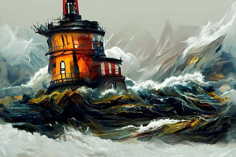</td>
  </tr>
  <tr>
    <td width="40%" valign="top"><b>Start image</b><br>Starts from an image instead of noise. At Denoise 60%, the paint's colors and bands carry through.<br><br><br><sub>The start image</sub></td>
    <td width="60%">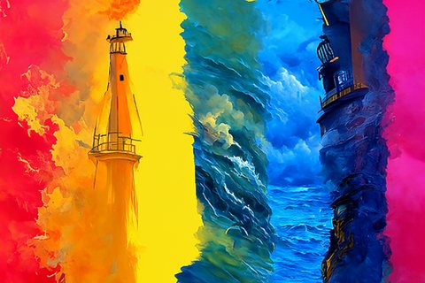</td>
  </tr>
  <tr>
    <td width="40%" valign="top"><b>Image prompts</b><br>A set of images acts as one more prompt, and what they have in common guides the render: here, a palette and brushwork. Nothing is trained.<br><br><br><sub>The six image prompts</sub></td>
    <td width="60%"></td>
  </tr>
  <tr>
    <td width="40%" valign="top"><b>Handoff 30%</b><br>A Stable Diffusion checkpoint you already have, SD 1.5 here, paints the first 30% from noise. Disco paints the rest.</td>
    <td width="60%"></td>
  </tr>
  <tr>
    <td width="40%" valign="top"><b>Ghost image</b><br>Borrows the image's layout of light and dark without painting the image in.<br><br>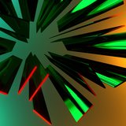<br><sub>The ghost image</sub></td>
    <td width="60%"></td>
  </tr>
  <tr>
    <td width="40%" valign="top"><b>Style image</b><br>Borrows the image's texture and palette.<br><br>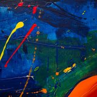<br><sub>The style image</sub></td>
    <td width="60%">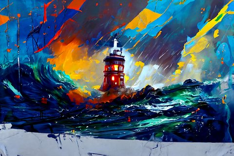</td>
  </tr>
</table>

### Looks and detail

<table>
  <tr>
    <td width="40%" valign="top"><b>Look: Fine detail</b><br>The prompt checkers study close detail through the whole render, which gives the crispest subjects and busier scenes.</td>
    <td width="60%"></td>
  </tr>
  <tr>
    <td width="40%" valign="top"><b>Look: Big shapes</b><br>The checkers always look at the whole picture, which gives bold, simple shapes.</td>
    <td width="60%"></td>
  </tr>
  <tr>
    <td width="40%" valign="top"><b>Look: Classic 2022</b><br>The settings of 2022 Disco renders: a gentler prompt, no smoothing and the secondary model. Dreamy and loose.</td>
    <td width="60%">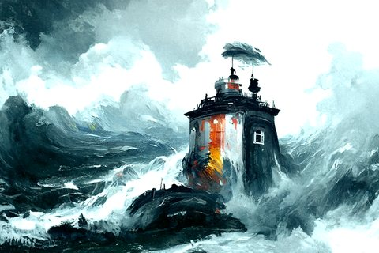</td>
  </tr>
  <tr>
    <td width="40%" valign="top"><b>Finest checker</b><br>Adds ViT-L/14, the largest prompt checker, for more detail. It needs offloading on 8GB, which Nano turns on by itself.</td>
    <td width="60%"></td>
  </tr>
</table>

### Experiments

<table>
  <tr>
    <td width="40%" valign="top"><b>Time travel</b><br>Steps back and repeats some steps, giving the image time to follow the prompt. Cleaner subjects, for about 35% more time.</td>
    <td width="60%"></td>
  </tr>
  <tr>
    <td width="40%" valign="top"><b>Prompt graft 3</b><br>Feeds the prompt straight into Disco's own decoder, which normally can't read text. Subjects come out whole.</td>
    <td width="60%">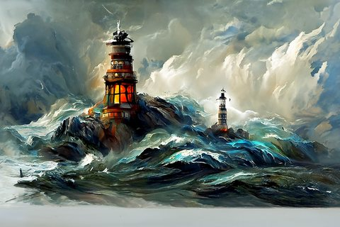</td>
  </tr>
  <tr>
    <td width="40%" valign="top"><b>Two painters</b><br>Tiny SD and Disco share every step: Tiny SD handles the broad shapes and Disco the detail.</td>
    <td width="60%"></td>
  </tr>
  <tr>
    <td width="40%" valign="top"><b>Borrowed attention</b><br>Gives Disco Tiny SD's sense of which parts of the picture belong together.</td>
    <td width="60%"></td>
  </tr>
  <tr>
    <td width="40%" valign="top"><b>Live ghost: Sketch first</b><br>Tiny SD paints a quick sketch first, and its light and dark guide the render.</td>
    <td width="60%"></td>
  </tr>
  <tr>
    <td width="40%" valign="top"><b>Sketch first + Depth target</b><br>The sketch also sets what is near and what is far.</td>
    <td width="60%"></td>
  </tr>
  <tr>
    <td width="40%" valign="top"><b>Push momentum 0.7</b><br>Carries part of each step's push into the next. Higher values are wilder and more abstract.</td>
    <td width="60%">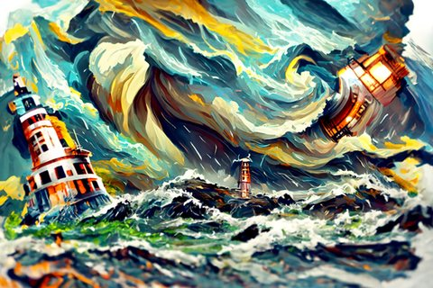</td>
  </tr>
</table>

## Requirements

- Windows 10 or 11
- An NVIDIA GPU with 8GB of VRAM or more, with a current driver
- About 15GB of free disk space, plus room for images and extra models
- An internet connection during setup

Nothing else needs installing first. Setup uses your Python 3.12 if you have it, and otherwise
downloads its own copy into Nano's folder.

## Install

1. Download the **Disco-Diffusion-Nano** zip from the
   [latest release](https://github.com/NeuromindArt/Disco-Nano/releases/latest), under **Assets**.
2. Extract it somewhere outside OneDrive, such as `C:\`. You get a **Disco Diffusion Nano** folder.
3. Double-click **setup.bat** in that folder. It installs everything into a `data` folder beside it:
   about 6GB of libraries and the 2GB main model, so the first run takes a while.
4. Double-click **Start Disco Nano.bat**. The black window shows what is loading, and the app opens
   in your browser at http://127.0.0.1:7861 when it is ready.

Closing the black window shuts Nano down. CLIP models download on your first render.

If Windows stops a .bat file with "Windows protected your PC", choose **More info** and then
**Run anyway**. To avoid this, right-click the zip before extracting it, choose **Properties**, tick
**Unblock** and click **OK**.

Windows often keeps the Desktop and Documents in OneDrive, which would upload the `data` folder, and
setup warns you if so. To keep the data elsewhere, create a file named `home.txt` beside `setup.bat`
containing the folder's path, or set `DISCO_NANO_HOME`, before running setup.

### Updating

Download the new release and extract it over the old folder, replacing its files. The `data` folder,
with your environment, models, images and settings, is kept. Then run **setup.bat** again, which only
installs what changed.

You can also clone this repository instead of downloading a release, and update with `git pull`.

### Folders

**All settings** sets where images are saved and which folders hold your upscalers and Stable
Diffusion checkpoints. A welcome screen asks about the first two the first time you open the app.
Point Nano at any folder of ESRGAN, DAT or HAT models, or download Real-ESRGAN x4plus from the app.
Nano also looks in `models/upscale_models` and `models/checkpoints` in the data folder, and finds the
checkpoints of ComfyUI and the Stable Diffusion web UIs on its own, grouped by their subfolders.

### Rendering on another PC

Like other local image generators, Nano can render on the PC with the GPU while you use it from
another one.

1. On the PC with the GPU, open **All settings**, and under **Network** turn on **Share this PC**.
   It shows an address, such as `http://192.168.1.20:7861`, and a code. Windows may ask once whether
   Python can use private networks. Choose Allow.
2. On the other PC, open that address in any browser, or type it into **Render on another PC** in
   Nano's own All settings. Type the code once, and the browser remembers it.

The other PC then uses Nano as if it sat at the GPU PC: renders run on that GPU, and images and
settings are saved there. The menu bar says which PC you are rendering on. Start images, videos and
guide images are uploaded when you drop them. **Browse** for a handoff checkpoint, and **Add folder**
for checkpoints and upscalers, show the GPU PC's own drives and folders, so you pick models that are
on that PC. Where images are saved, and opening Explorer, are set on the GPU PC itself. **New code** signs every other PC out. Sharing stays off until you turn it on, and
then Nano answers only on your local network, and only to browsers with the code.

### Optional machine settings

A file named `local.json` in the data folder holds machine settings. These two have no control in
the app:

```json
{
  "vit_l14_weights": ["D:/models/open_clip_model.safetensors"],
  "other_gpu_ports": [8188, 7860]
}
```

`vit_l14_weights` reuses a copy of ViT-L/14 you already have. `other_gpu_ports` are local apps that
trigger a warning when they are running.

## Models

Setup downloads the main 512×512 model and the secondary model. The others in the Model list are
grayed out until you download them from the welcome screen or from Models in All settings. Each is
0.4GB to 2GB, and all were tested at 512×512 on an RTX 3070 8GB. The seven style models are the
lightest, at about 3.7GB of VRAM and half the time of the main model.

## What fits on 8GB

Measured on an RTX 3070 with the app open in a browser. Horizontal and vertical run at the same
speed.

| Setup | Size | Seconds per step |
|---|---|---|
| 3 CLIP models | 768×512 | 1.11 |
| 3 CLIP models | 1024×576 | 1.54 |
| 3 CLIP models, Offload | 1280×768 | 4.56 |
| 3 CLIP models, secondary model | 1280×768 | 1.32 |
| 4 CLIP models | 512×512 | 1.24 |
| 4 CLIP models, Offload | 1280×768 | 5.48 |

3 CLIP models means ViT-B/32, ViT-B/16 and RN50. 4 adds ViT-L/14. Other GPU apps lower these limits,
so unload their models first. A render at the default 768×512 and 200 steps takes about 4 minutes.

Sizes are multiples of 64, so 1280×720 becomes 1280×704.

### The memory bars

The three bars at the bottom of the window work the same way. Gray on the left is what the rest of
the PC uses. Disco follows in color: green on VRAM, blue on RAM, and purple for its files on the disk.
Before a render, Disco's part is lighter and shows what the next render will take, so it grows as you
add prompt checkers, raise the size or turn on extras such as the partner model. While a render runs, it turns solid
and shows what Disco really uses. Hover any part to see its size. The striped end of VRAM is the
0.75GB kept free for Windows.

When a render won't fit in what is free, part of its working data moves to system RAM by itself.
That part shows green inside the RAM bar, and the render runs slower. Red means a render is too big
even then: lower the size, use fewer prompt checkers, or close other GPU apps. These estimates were
measured on an RTX 3070 and scale the same way on other cards.

## How it fits and why it is fast

Disco Diffusion's memory problem is the opposite of Stable Diffusion's. The weights are only about
1GB. The rest is full-size working data kept for the guidance backward pass.

- **One UNet pass per step.** Disco Diffusion runs the UNet twice each step on the same input. Nano
  runs it once and shares the result, which took 768×512 from 1.5 to 1.16 seconds per step.
- **One cutout batch.** Disco Diffusion's default of 4 repeats the CLIP work four times. Raise
  **View rounds** (`cutn_batches`) in the Views card if you prefer that.
- **Lean UNet blocks.** At 1280×768 one copy of a full-size layer is up to 0.7GB, and the stock blocks
  keep four or five copies alive at once. Nano's blocks reuse buffers when nothing needs gradients,
  and in the guidance backward pass each block keeps only its input and steps back through itself
  by hand, freeing each buffer as soon as it is used. The arithmetic is the same, so renders are
  identical to the stock code.
- **16-bit group norm on large layers.** guided-diffusion converts each layer to 32-bit just to
  normalize it, doubling that layer's memory.
- **ViT-L/14 sees its cuts four at a time**, which gives the same gradient in much less memory.
- **CLIP text encoders leave the GPU** once the prompt is encoded.
- **The start image comparison loads only when it is used.**
- **Offload** moves the large activations to system memory, along with the CLIP image models while
  the UNet runs backward. It is the counterpart of ComfyUI's low-VRAM modes, and it turns on by
  itself when the memory plan says a render won't fit in the VRAM that is free.
- **A hard VRAM cap.** On Windows, nearly full VRAM does not fail cleanly: video memory gets paged,
  the GPU drops to idle clocks, renders stall for minutes and the desktop can freeze. Each job is
  capped 0.75GB below what is free when it starts, so it gets an out-of-memory error instead.
  ComfyUI keeps 0.6GB free on Windows for the same reason.

## Starting from an image

Drop an image on the box under the prompt, click the box to choose one, or drag a finished render
onto it from Images. Then choose how it is sized to the frame:

- **Match** sets the frame to the image's shape. It never makes the frame larger.
- **Fit** keeps the whole image over a blurred copy of itself.
- **Fill** stretches the whole image to the frame.
- **Crop** fills the frame without stretching and cuts off what does not fit.

Set **Denoise** between 30% and 70%. Adding a start image sets it to 50%, which carries over the
layout and colors and repaints the details. Lower stays closer to the image. With official names
on, Denoise shows as **skip_steps**, the number of steps skipped at the start.

**Strength**, below it, works differently. Denoise decides how much of the image is repainted.
Strength pulls the render back toward the image at every step, by how alike the two look. 0 turns it
off.

## Image prompts

Drop a set of images, or a whole folder, on **Image prompts** under **Guide images**, and they guide
the render alongside your text. Each prompt checker reads every image, and Nano averages what it
sees into one more prompt. What the images have in common counts: a subject, a style, a palette, a mood.

It does the job of an embedding, such as a textual inversion, without any training. A folder takes
seconds to read and works with any images. Ten to fifty images that share one idea work best, and
up to 200 are read. **Image prompt weight** sets how much they count beside a text line weighted 1,
and a weight below 0 steers away from them.

## Looks and Denoise

With text alone, keep **Denoise** at 100%. The first steps of a render lay out the scene, and
skipping them leaves CLIP only texture to work with. Earlier versions of Nano skipped a quarter of
the steps, which often gave a pleasant texture in place of the subject.

A **Look** sets how the prompt shapes the picture, at any size:

- **Balanced**, the default. The prompt checkers lay out the whole scene first, then look closer
  toward the end to add detail. Strong single subjects. This is the close-up ramp: **Close-up
  tightness** starts low, so close-ups are wide, and rises toward the end.
- **Fine detail**. The checkers look closely from start to end. The crispest subjects, faces and
  textures, with busier scenes.
- **Big shapes**. The checkers look at the whole picture throughout. Bold, simple scenes and dioramas.
- **Classic 2022**. Settings from 2022 Disco renders: a gentler prompt, no smoothing, five rounds of
  cutouts and the secondary model. Dreamy and loose, and about twice as long.

Changing one of a look's settings by hand shows **Custom**.

The **Views** card (**Cutouts** under official names) holds the schedules behind the looks: how many
whole-image views and close-ups the checkers judge, how tight the close-ups are, and how many are
gray. Each schedule shows as a graph from the start of the render to the end. Click one to drag its
levels, for example to start the ramp later or end it tighter. The **Guidance** card holds smoothing,
the saturation and step limits, and the sampler. Changed values show in the accent color.

## Handoff

**Handoff** lets a Stable Diffusion checkpoint you already have, SD 1.5 or SDXL, start every image or
frame. It isn't a start image. The checkpoint takes its share of the steps from pure noise, and
Disco carries on from the exact point where it stopped, while the scene is still blurry. The checkpoint decides the layout and subject, and Disco paints it.

- **Handoff model** lists the SD 1.5 and SDXL checkpoints in your checkpoint folders and in ComfyUI or
  a Stable Diffusion web UI on the PC, grouped by subfolder. **Browse** picks one anywhere on the PC
  and adds its folder. Checkpoints are read where they are.
- **Handoff %** is the checkpoint's share of the path from noise to picture. 0% is Disco alone.
  About 30% keeps Disco's look on a sturdier layout, 50% keeps more of the checkpoint, and 100%
  leaves Disco only the finishing touch.
- **Disco denoise %** is how much of the checkpoint's picture Disco repaints, like Denoise for a start
  image. At 0 Disco carries on from exactly where the checkpoint stopped. With Handoff % at 60, 75
  here has Disco repaint with 150 of 200 steps.
- **Reverse handoff %** works the other way round, like Denoise for the checkpoint after Disco is done: it
  repaints that much of the finished image. 0 is off, about 20 to 35 tidies details and keeps
  Disco's look, and 100 replaces Disco's image. It works with Handoff % at 0, so
  the checkpoint only finishes, and on still images only. Keep the handoff picture also saves
  Disco's own image beside it.
- With a start image, or on any frame of a 2D, 3D or Video Input clip, the checkpoint starts where
  Disco would have started and takes its share of what is left. Every painted frame gets it.
- Handoff steps, its prompt strength, its negative prompt, and spacing for few-step models such as
  Lightning are under More settings in the Handoff card. Prompt lines with a negative weight become part of
  its negative prompt.

The checkpoint waits in RAM and comes to the GPU only for its own steps. On cards under 12GB, SDXL's
UNet is stored in 8 bits, which halves it to 2.6GB, and Disco repaints what follows, which hides the
small loss. If the checkpoint and Disco still don't fit together, Nano moves Disco's models to RAM
while the checkpoint paints. Loading an SDXL file takes a minute or two the first time; after that it
waits in RAM for the next render (see Keep models loaded below). Whatever the frame size, the checkpoint paints at 512 to
768 pixels a side, in the frame's shape. The first use downloads a few small configuration files from Hugging Face.


The same prompt and seed at 768×512 and 200 steps, with SD 1.5 (revAnimated) as the Handoff model,
on an RTX 3070 8GB. Each step the checkpoint takes is one Disco doesn't, so Handoff also saves
time. All three peaked at 5.2GB, and so did SDXL at 30%, which took 146 seconds at 60 steps
including loading the file.

## Tiles

**Tiles** builds a larger image from several renders at the frame size. It needs no more VRAM than
the frame does, and time grows with the number of tiles. The tiles take each step in turn, and
the overlaps are merged before the next step, so neighbors settle on one image instead of being
joined afterward. The join moves at random inside the overlap every step, so it can't harden into a
straight line.

| Tiles | Final size from a 768×512 frame |
|---|---|
| 2x, 4 tiles | 1440×928 |
| 3x, 9 tiles | 2112×1344 |
| 4x, 16 tiles | 2784×1760 |

- **With a start image**, **Tile denoise** sets how much is repainted, in place of Denoise. The
  image can be any size, because it is resized to the final size first.
- **With text only**, **Text start** chooses how the picture begins. **Render first**, the default,
  paints one image at the frame size and then the tiles repaint it using Tile denoise. It keeps one
  scene with large shapes, and 0.5 is a good start. **Split the noise** paints at full size from the
  first step and uses Denoise. It is busier, and each tile can paint its own copy of the subject.
- **Whole picture view** lets CLIP see each tile as part of the full image.
- **Tile overlap**, under More settings in the Tiles card, is how many pixels neighbors share. The
  default is 96.

Tiles always use the ddim sampler, and symmetry doesn't apply.

**Tiles in animation** tile every frame, so a clip takes about as many times longer as there are
tiles. The first frame follows the rules above, a video's frames use Tile denoise, and every later
frame uses Frame skip %.

Tested on an RTX 3070 8GB: a 2x render from a 768×512 frame at 100 steps, with Tile denoise 0.5,
took about 6 minutes and peaked at 5.2GB. The picture below is one, made with Render first. 3x and
4x were tested on small frames only. Tiles lose sharpness at low step counts, so use at least 50
steps per tile, which is 100 steps at Tile denoise 0.5.


## Animation

<table>
  <tr>
    <td width="33%" valign="top"><br><b>2D</b><br><sub>48 frames, zooming and turning. About 20 minutes.</sub></td>
    <td width="33%" valign="top">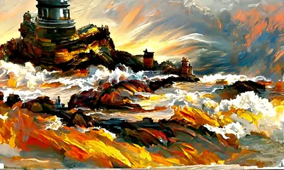<br><b>3D</b><br><sub>48 frames, flying along the coast. About 20 minutes.</sub></td>
    <td width="33%" valign="top"><br><b>Video Input</b><br><sub>40 frames of a foggy road video from <a href="https://www.pexels.com">Pexels</a>. 52 minutes.</sub></td>
  </tr>
</table>

All three are 640×384 at 200 steps on an RTX 3070 8GB, shown smaller here. The 2D and 3D clips use
Turbo every 2nd frame and 2 in-between frames. The video clip uses every 4th frame of the video,
Frame skip 55%, Blend last frame 0.4 and one in-between frame, and peaked at 4.3GB.

**Animation** renders a clip one frame at a time. Each frame after the first starts from the last
one, and **Frame skip %** decides how much of it is kept.

- **2D** zooms, turns and pans a flat picture.
- **3D** flies a camera through the scene. Depth Anything V2 Small tells near from far, so 3D needs
  it from Models in All settings, about 100MB.
- **Video Input** repaints a video you drop on its box, frame by frame. **Blend last frame** mixes
  the last finished frame into each new one, moved along the video's own motion, so the paint
  travels with what moves.

**Frame skip %** defaults to 75 for camera moves, which holds a scene while it moves, and to 55 for
Video Input, so the video gets repainted more. **Frame skip keyframes**, under More settings in the Animation card, can lower it
around a prompt change. For calmer, more painterly clips, try **Step noise** at about 0.3.

Each move has a slider for a steady value and a keyframe box for change over time, in Disco
Diffusion's form: `0:(1.0), 60:(1.04), 120:(1.0)`. Formulas of the frame `t` work too, such as
`0:(1+0.02*sin(t/8))`. The curve button beside each move opens an editor where you can drag the
keyframes.

The prompt box holds the prompt at the first frame. **Change the prompt at a frame** adds another box
with the frame it starts at, so a clip can travel from one idea to the next. **Prompt fade** in All
settings blends one into the next.

- **Hold colors** matches each frame's light and color to the first frame's, so long clips don't
  drift or burn out.
- **Turbo** repaints only every few frames, and the camera moves the frames between. They fade
  toward the next repaint, so it doesn't pulse. Every 3 frames is about 2.5 times faster.
- **Last frame as ghost** lets the Experiments' ghost guidance hold each frame to the last one.
- **In-between frames** adds up to 3 frames between each pair of painted ones, for smoother motion
  at no extra render time. The clip keeps its length, because the frame rate is raised to match.
  RIFE 4.7 paints them if you get it from Models in All settings, about 21MB. Without it, optical
  flow does, which can ghost on fast motion.
- A stopped clip still saves the video of the frames it has. Right-click a clip and choose
  **Continue the clip** to carry on from its last frame, or raise Frames first to lengthen it.

Each clip is saved as PNG frames in a folder, an MP4 and an animated WebP, plus a GIF if you choose.
The last frame shows in Images with a play mark, and clicking it plays the clip.

## Good to know

- **Seed** 0 picks a new random seed for each render. Any other number starts from the same noise.
- A seed alone does not repeat an image. Small GPU differences grow during a render, so the same
  seed can give a different composition. Turn on **Exact repeat** for an identical image. It adds
  about 28% to each step, and holds only on the same PC, drivers and software.
- Each image in a run has its own seed, so **Reuse settings** can make any of them again if the run
  used Exact repeat.
- Settings that can't work together gray out as you choose them, and hovering one says why. The
  Experiments, for example, can't run with tiles, mirroring, plms or the secondary model. A setting
  that is already on turns red instead, so you can switch it off, and a render with a conflict is
  refused. Every pair of options the rules allow, across all modes, was rendered in a 37-run test, and
  all of them worked.
- **Color range** (`range_scale`) did nothing in the original Disco Diffusion. Its penalty was measured
  on an image the guidance can't reach, so its push was always zero. Nano measures it on the image
  being guided, so it works, and it is off by default so renders keep their original look.
- **Images** shows each folder in your output folder as a section that opens and closes. Drag an
  image onto a folder to move it there, with its settings, upscales and clip files. **New folder**
  makes one, and folders you make in Explorer show up too. **Folder name** under Render sets where
  new renders go.
- **Keep models loaded**, in All settings and on by default, keeps the last render's models waiting in
  RAM, so the next render starts in a few seconds instead of about 20, or about 2 minutes with an SDXL
  handoff model. Changing a model loads only that one. Exact repeat and frames over about half a
  megapixel need a fresh render process, so switching those starts one. Closing the app frees it all.
- **Save progress video**, in All settings, saves an MP4 of the picture forming beside each still
  image, one frame per preview. **Preview every** is 1 step by default, so the preview and the video
  show every step.

## Support

Nano is free. If it is useful to you, you can support its development on
[Ko-fi](https://ko-fi.com/neuromindart). More of my work is at [neuromind.art](https://neuromind.art).

## Credits and license

Nano is MIT licensed. It is derived from Disco Diffusion and builds on many people's work: see
[CREDITS.md](CREDITS.md) and the [LICENSES](LICENSES) folder.
