

# Disco Diffusion Nano

**Disco Diffusion as a local Windows app, rebuilt for 8GB graphics cards.**

Nano keeps Disco Diffusion's painterly, CLIP-guided look and drops the notebook. It runs as a local
web app with live previews and a gallery, and fits full-size renders on an 8GB card.

  
  

1024×576, 200 steps, default settings: about 6 minutes each on an RTX 3070 8GB.

## Features

- Live previews, a gallery with folders, and right-click to upscale, reuse or send any image back in
- Start images, video input, guide images and image prompts, dropped straight onto the page
- **Handoff**: an SD 1.5, SDXL, Z-Image, Flux.1 or Flux.2 Klein model lays out the scene, and Disco paints it
- **Fix**: pause a render to erase, clone or inpaint part of the picture
- **Regional prompts**: boxes on the frame, each with its own prompt
- **Controls**: hold a picture's outlines, depth, pose, people or faces, as ControlNet does
- **Tiles**: images up to 64 tiles in size, without seams
- **Animation**: 2D and 3D camera moves or a repainted video, with keyframes and seamless loops
- **Experiments** that change how the image forms
- VRAM, RAM and disk bars, automatic offloading, and a hard VRAM cap so a render never stalls the PC
- Render on the PC with the GPU from any browser on your network
- Plain names for every setting, or Disco Diffusion's official ones, with help on hover

## Requirements

- Windows 10 or 11
- An NVIDIA GPU with 8GB of VRAM or more
- About 15GB of free disk space
- An internet connection during setup

Setup uses your Python 3.12 if you have one, and otherwise downloads its own.

## Install

1. Download the zip from the [latest release](https://github.com/NeuromindArt/Disco-Nano/releases/latest), under **Assets**.
2. Extract it outside OneDrive, such as to `C:\`.
3. Double-click **setup.bat**. It installs everything into a `data` folder, and uses models that
   ComfyUI or a Stable Diffusion web UI already has instead of downloading them again.
4. Double-click the **Disco Nano** shortcut setup makes. The app opens in your browser at
   http://127.0.0.1:7861. Closing the black window shuts it down.

If Windows says "Windows protected your PC", choose **More info**, then **Run anyway**. To keep the
`data` folder somewhere else, put its path in a `home.txt` file beside `setup.bat` before running setup.

**Updating:** extract the new release over the old folder and run **setup.bat** again. Your `data`
folder, with models, images and settings, is kept. Or clone the repository and `git pull`.

**Rendering on another PC:** turn on **Share this PC** in Settings on the PC with the GPU. It shows an
address and a code to open from any browser on your network.

## What each option does

The same prompt, *A beautiful painting of a lighthouse in a stormy sea*, and seed at 768×512 and 200
steps, changing only the option beside it. Guide images are from [Pexels](https://www.pexels.com).

### Starting points and guides

<table>
  <tr>
    <td width="40%" valign="top"><b>Default settings</b></td>
    <td width="60%"></td>
  </tr>
  <tr>
    <td width="40%" valign="top"><b>Start image</b> Starts from an image instead of noise, here at Denoise 60%.   The start image</td>
    <td width="60%"></td>
  </tr>
  <tr>
    <td width="40%" valign="top"><b>Image prompts</b> A set of images used as one more prompt.   The six image prompts</td>
    <td width="60%"></td>
  </tr>
  <tr>
    <td width="40%" valign="top"><b>Handoff 30%</b> An SD 1.5 checkpoint paints the first 30%, and Disco the rest.</td>
    <td width="60%"></td>
  </tr>
  <tr>
    <td width="40%" valign="top"><b>Ghost image</b> Borrows the image's light and dark.   The ghost image</td>
    <td width="60%">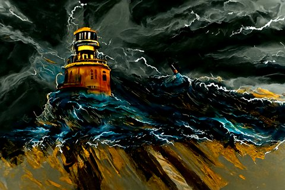</td>
  </tr>
  <tr>
    <td width="40%" valign="top"><b>Style image</b> Borrows the image's texture and palette.   The style image</td>
    <td width="60%"></td>
  </tr>
</table>

### Looks and detail

<table>
  <tr>
    <td width="40%" valign="top"><b>Look: Mostly detail</b> Crisp textures and busier scenes.</td>
    <td width="60%">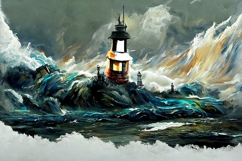</td>
  </tr>
  <tr>
    <td width="40%" valign="top"><b>Look: Mostly shapes</b> Bold, simple shapes.</td>
    <td width="60%"></td>
  </tr>
  <tr>
    <td width="40%" valign="top"><b>Look: Classic 2022</b> The settings of 2022 Disco renders. Dreamy and loose.</td>
    <td width="60%"></td>
  </tr>
  <tr>
    <td width="40%" valign="top"><b>Finest checker</b> Adds ViT-L/14, the largest CLIP model, for more detail.</td>
    <td width="60%">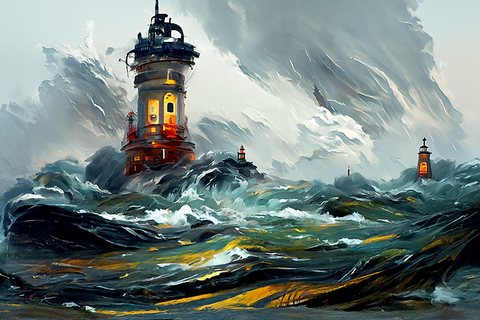</td>
  </tr>
</table>

### Experiments

<table>
  <tr>
    <td width="40%" valign="top"><b>Time travel</b> Steps back and repeats some steps. Cleaner subjects, for about 35% more time.</td>
    <td width="60%">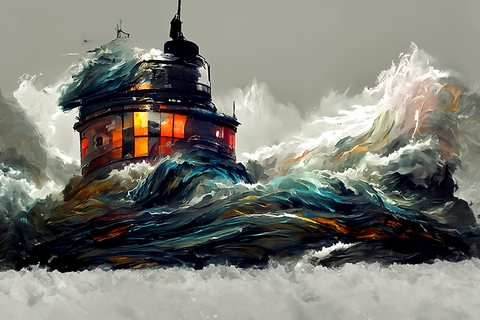</td>
  </tr>
  <tr>
    <td width="40%" valign="top"><b>Prompt graft 3</b> Feeds the prompt into Disco's own decoder. Subjects come out whole.</td>
    <td width="60%"></td>
  </tr>
  <tr>
    <td width="40%" valign="top"><b>Two painters</b> Tiny SD paints the broad shapes and Disco the detail, sharing every step.</td>
    <td width="60%"></td>
  </tr>
  <tr>
    <td width="40%" valign="top"><b>Borrowed attention</b> Gives Disco Tiny SD's sense of which parts belong together.</td>
    <td width="60%">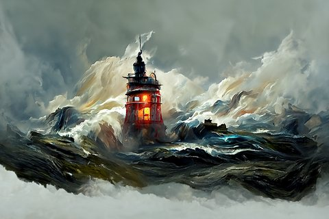</td>
  </tr>
  <tr>
    <td width="40%" valign="top"><b>Live ghost: Sketch first</b> Tiny SD paints a quick sketch whose light and dark guide the render.</td>
    <td width="60%">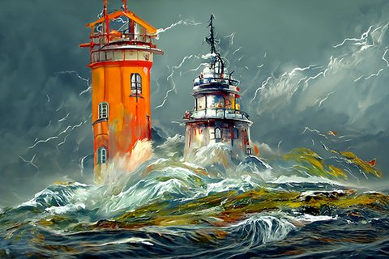</td>
  </tr>
  <tr>
    <td width="40%" valign="top"><b>Sketch first + Depth target</b> The sketch also sets what is near and far.</td>
    <td width="60%"></td>
  </tr>
  <tr>
    <td width="40%" valign="top"><b>Push momentum 0.7</b> Wilder and more abstract.</td>
    <td width="60%"></td>
  </tr>
  <tr>
    <td width="40%" valign="top"><b>Coherence critic 0.6</b> Rewards how the parts fit together, for whole subjects.</td>
    <td width="60%">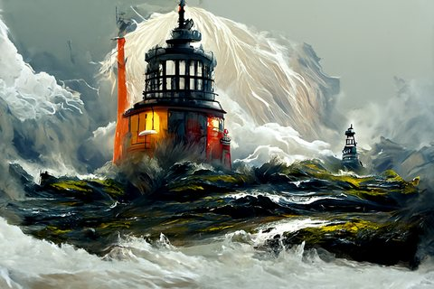</td>
  </tr>
  <tr>
    <td width="40%" valign="top"><b>Robust checker: FARE4 B/16</b> A robust CLIP model leads the first third, drawing real shapes instead of streaks.</td>
    <td width="60%">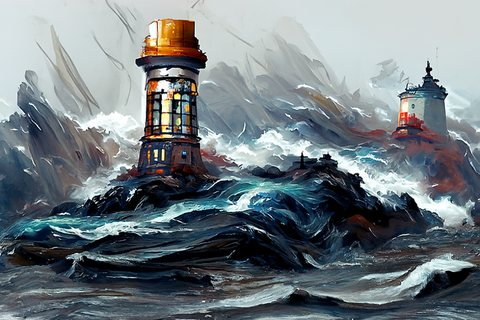</td>
  </tr>
  <tr>
    <td width="40%" valign="top"><b>One subject 1</b> Keeps <i>a lighthouse</i> in one place, so it isn't repeated.</td>
    <td width="60%">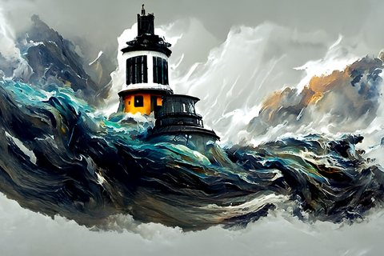</td>
  </tr>
  <tr>
    <td width="40%" valign="top"><b>Corrector steps 1</b> A small extra step after each early step. About 45% more time.</td>
    <td width="60%">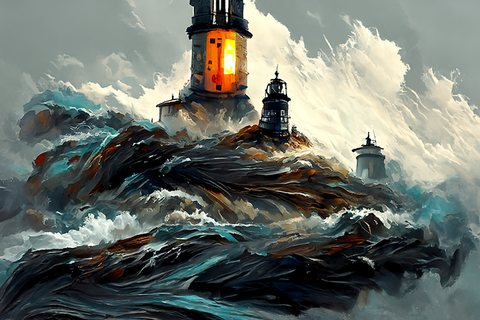</td>
  </tr>
  <tr>
    <td width="40%" valign="top"><b>Prompt routing: Split</b> The subject is judged on whole views and the style on close-ups.</td>
    <td width="60%">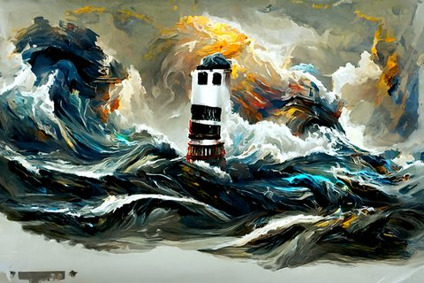</td>
  </tr>
</table>

## Models

Setup downloads the main model and the secondary model. The others in the Model list, and extras such
as Depth Anything, Tiny SD, LaMa and RIFE, download from **Models** in Settings.

Checkpoint and upscaler folders are set in Settings. Nano finds ComfyUI's and Stable Diffusion web UI's
folders on its own.

## What fits on 8GB

Measured on an RTX 3070:

| Setup | Size | Seconds per step |
|---|---|---|
| 3 CLIP models | 768×512 | 1.11 |
| 3 CLIP models | 1024×576 | 1.54 |
| 3 CLIP models, Offload | 1280×768 | 4.56 |
| 3 CLIP models, secondary model | 1280×768 | 1.32 |
| 4 CLIP models | 512×512 | 1.24 |
| 4 CLIP models, Offload | 1280×768 | 5.48 |

3 CLIP models is ViT-B/32, ViT-B/16 and RN50; 4 adds ViT-L/14. Sizes are multiples of 64.

The bars at the bottom show VRAM, RAM and disk: gray for the rest of the PC, color for Disco. Before a
render they show what it will need. Offload turns on by itself when a render won't fit, and red means
it won't fit even then.

### How it fits

- One UNet pass per step instead of two
- One cutout batch by default (**View rounds** sets more)
- UNet blocks that free their buffers as they go, with identical results
- 16-bit group norm on large layers
- ViT-L/14 reads its cutouts four at a time
- CLIP text encoders leave the GPU once the prompt is read
- Offload of large activations to RAM when needed
- A hard VRAM cap 0.75GB below what is free, so a render fails cleanly instead of stalling Windows

## Starting from an image

Drop an image under the prompt and choose how it fits the frame: **Match**, **Fit**, **Fill** or
**Crop**. **Denoise** sets how much is repainted: 50% by default, lower stays closer to the image.
**Strength** pulls the render back toward the image at every step.

**Guide images** steer a render without being painted in:

- **Ghost image** lends its light and dark. **Ghost settings** hold its strength and curve.
- **Style image** lends its texture and palette.
- **Image prompts** take a set of images, or a folder, as one more prompt. What they share counts: a
  subject, a style, a palette. Ten to fifty images that share one idea work best.

## Looks

With text alone, keep Denoise at 100%. A **Look** sets how the steps are split between laying out
shapes and painting detail:

- **Shapes, then detail** (default): 40% shapes, 60% detail. Strong single subjects.
- **Mostly detail**: 10% shapes. Crisp textures and busy scenes.
- **Mostly shapes**: 80% shapes. Bold, simple scenes.
- **Classic 2022**: the settings of 2022 Disco renders. Dreamy and loose, about twice as long.

The **Views** card holds the schedules behind the looks as graphs you can drag, and a bar showing
which steps lay out shapes and which paint detail. With a start image, **Fit views to the painted
steps** gives the steps that are painted their own pass of shapes.

## Handoff

**Handoff** lets a model you already have paint first, and Disco repaints its picture. It can also run
the other way round, with the model finishing Disco's image.

- **Supported:** SD 1.5 and SDXL checkpoints, and Z-Image, Flux.1 and Flux.2 Klein as `.safetensors`
  or `.gguf`, with their text encoders and VAE in your models folders, as ComfyUI keeps them.
  Choosing one sets the steps and CFG it was made for.
- **Handoff %** is how much of its picture the model paints. At 100 it finishes it, and Disco repaints
  **Denoise** of it. Around 30 keeps Disco's look on a sturdier layout.
- **Start denoise %** is how much of a start image the model repaints.
- **Finish %** has the model repaint that much of Disco's finished image. About 20 to 35 tidies details.

The model waits in RAM and comes to the GPU only for its own steps.

### Small first

Large frames such as 1280×768 often repeat the subject. **Small first**, in the Size card, paints the
first steps at a smaller size, then carries on at full size, so the layout has one subject. About 25%
suits 1280×768. **Hold the small layout** keeps a second subject from growing in empty areas.

## Regional prompts

Turn on **Regional prompts**, press **Edit regions**, and drag on the frame to draw a box with its own
prompt. Press **Pause and edit regions** during a render to draw on what has been painted so far.
**Strength** sets how much a box's prompt takes over inside it. Works with stills, clips and Tiles.

## Fix

Press **Fix** during a render to pause it, paint on the preview, and press **Apply and continue**.
It also works on the start image, before a render.

<table>
  <tr>
    <td width="40%" valign="top"><b>Without a fix</b> Extra lighthouses: a red one in the water, and one on the far headland in the clouds.</td>
    <td width="60%">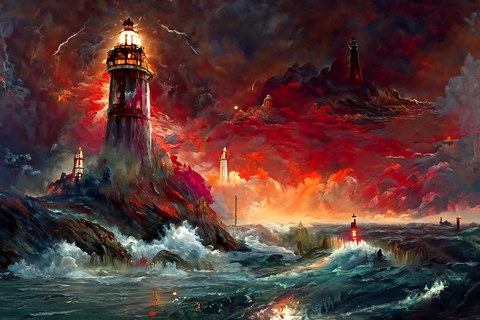</td>
  </tr>
  <tr>
    <td width="40%" valign="top"><b>Erase</b> The lighthouse in the water, erased from 53% each time it grew back.  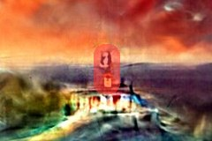 The first erase</td>
    <td width="60%">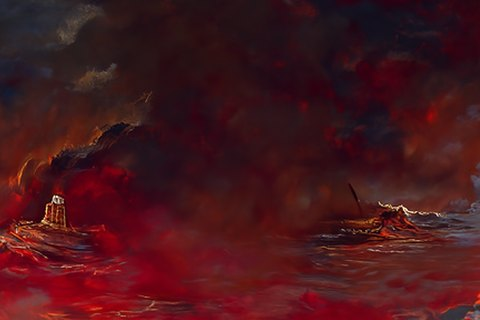</td>
  </tr>
  <tr>
    <td width="40%" valign="top"><b>Clone</b> The tower in the clouds, covered with sky from its left at 80%.  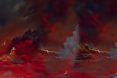 The area and its source</td>
    <td width="60%">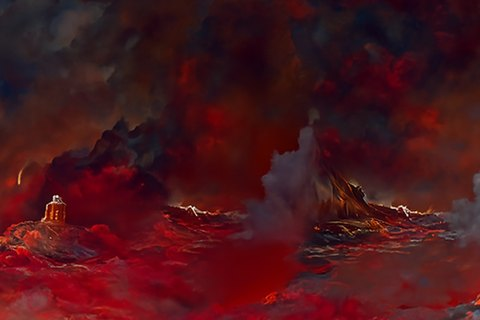</td>
  </tr>
  <tr>
    <td width="40%" valign="top"><b>Inpaint</b> <i>a small wooden sailboat</i> by Flux Fill at 60%, then painted on by Disco.  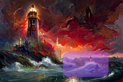 Where the boat goes 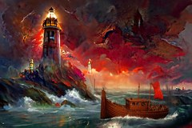 Flux Fill's try</td>
    <td width="60%">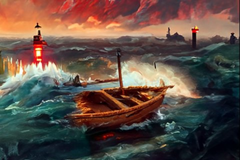</td>
  </tr>
</table>

- **Erase** removes what you paint over. [LaMa](https://github.com/advimman/lama) fills the area and
  Disco repaints it. Best before about 80%; later, use Clone.
- **Clone** copies one part of the picture over another. Alt-click the source, then paint.
- **Inpaint** has a model of your own paint into the area, from a prompt or from what surrounds it.
  Choose the model under **Inpaint** in Settings: Flux Fill, or any model Handoff takes. It paints a
  few tries to choose from first.

The prompt can grow something back, above all what it asks for. Fix it again when it shows. **Noise**
on the bar sets how much fresh noise a fix gets: raise it if something keeps coming back, lower it if
the area turns grainy. Keys: **[** and **]** for brush size, **E**, **C** and **I** for the tools,
Ctrl+Z to undo.

## Controls

**Controls** hold parts of a control picture while Disco paints, ControlNet's idea done through
guidance. The control picture is the **Control image**, the start image, or each frame of a video.

- **Edge**: outlines
- **Depth**: near and far
- **Pose**: each person's stance
- **Person**: each person's silhouette and broad colors
- **Face**: where each face's features are
- **Face shape**: each face's outline and turn
- **Face detail**: extra close-ups on faces, which helps even with text alone

About 0.5 is a good start. Each control has a curve for when it counts. Controls don't work with Tiles.

## Experiments

The **Experiments** card holds ideas that change how the image forms, shown above under
[What each option does](#what-each-option-does). Results vary a lot from seed to seed, and they don't
run with Tiles, symmetry, plms or the secondary model.

Prompt graft, Live ghost, Two painters and Borrowed attention need Tiny SD, from Models. Depth target
needs Depth Anything. Robust checkers download from Models too.

## Tiles

**Tiles** builds a larger image from several renders at the frame size, with no more VRAM. The tiles
take each step in turn and share a quarter of each side, so joins don't show.

| Tiles | Size from a 768×512 frame |
|---|---|
| 2x, 4 tiles | 1344×896 |
| 3x, 9 tiles | 1920×1280 |
| 4x, 16 tiles | 2496×1664 |
| 6x, 36 tiles | 3648×2432 |
| 8x, 64 tiles | 4800×3200 |

With text alone, **Render first** paints one image at the frame size and the tiles repaint it. With a
start image, Denoise works as usual. Use at least 50 steps per tile. A 4x render at 200 steps takes
about 40 minutes on an RTX 3070.

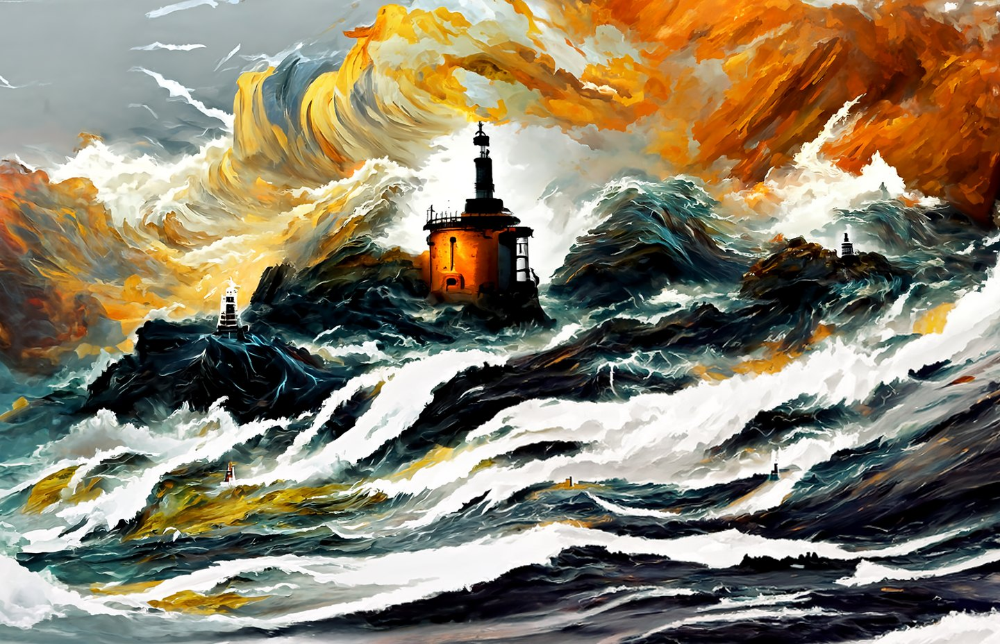

## Animation

<table>
  <tr>
    <td width="33%" valign="top">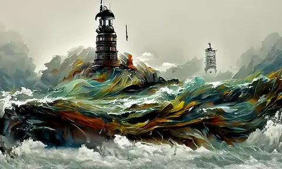 <b>2D</b> 48 frames, about 20 minutes</td>
    <td width="33%" valign="top"> <b>3D</b> 48 frames, about 20 minutes</td>
    <td width="33%" valign="top"> <b>Video Input</b> 40 frames of a <a href="https://www.pexels.com">Pexels</a> video, 77 minutes</td>
  </tr>
</table>

- **2D** zooms, turns and pans. **3D** flies a camera through the scene, and needs Depth Anything.
  **Video Input** repaints a video frame by frame.
- **Frame skip %** sets how much of the last frame each new one keeps. **Clip style** sets it for
  video: **Paint over**, **Reimagine** or **Build up**.
- Moves take keyframes in Disco Diffusion's form, `0:(1.0), 60:(1.04)`, or formulas of `t`, with a
  curve editor.
- **Change the prompt at a frame** makes a clip travel from one idea to the next.
- **Turbo** repaints every few frames. **In-between frames** add smooth motion with RIFE.
  **Hold colors** stops long clips drifting. **Seamless loop** ends where the clip began.

Clips save as PNG frames, MP4 and WebP, plus GIF if you choose. Right-click a clip to continue it.

## Good to know

- **Seed** 0 picks a new seed each render. The same seed can still give a different image; turn on
  **Exact repeat** for an identical one, at about 28% more time.
- Settings that can't work together gray out, and hovering says why.
- **Color range** (`range_scale`) works in Nano. In the original Disco Diffusion it did nothing.
- **Keep models loaded**, on by default, keeps models in RAM so the next render starts in seconds.
- **Save progress video** saves an MP4 of the picture forming.

## Support

Nano is free. If it is useful to you, you can support it on [Ko-fi](https://ko-fi.com/neuromindart).
More of my work is at [neuromind.art](https://neuromind.art).

## Credits and license

Nano is MIT licensed. It is derived from Disco Diffusion and builds on many people's work: see
[CREDITS.md](CREDITS.md) and the [LICENSES](LICENSES) folder.
