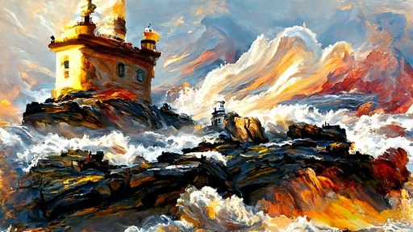
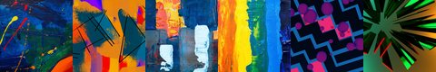
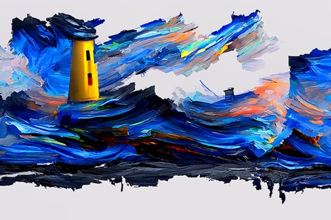
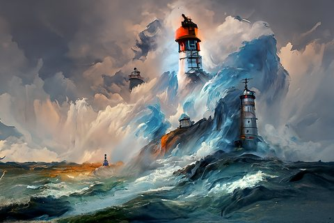
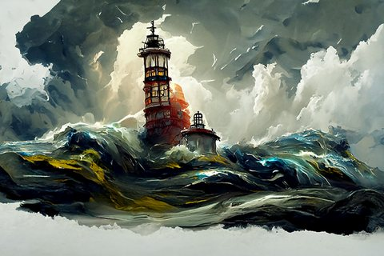
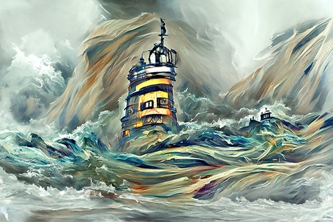
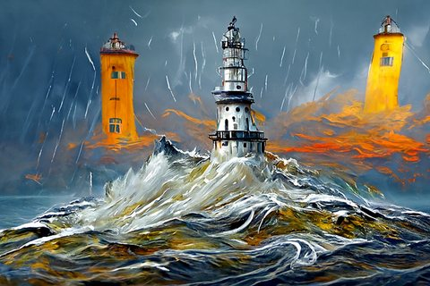
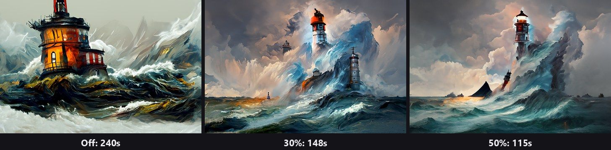
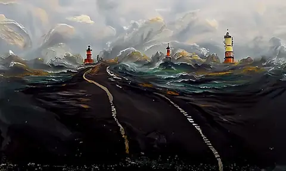

<div align="center">


# Disco Diffusion Nano

**Disco Diffusion as a local Windows app, rebuilt for 8GB graphics cards.**

[](https://ko-fi.com/neuromindart)
[](https://neuromind.art)
[](LICENSE)

</div>

Nano keeps Disco Diffusion's painterly, CLIP-guided look and drops the notebook. It runs as a local
web app with live previews and a gallery, and its memory savings fit full-size renders on an
RTX 3070.


<p>
  
  
</p>

Each picture is 1024×576 at 200 steps with the default settings, and took about 6 minutes on an
RTX 3070 8GB.

## Features

- Horizontal or vertical renders with one click, up to 1280 on the long side
- Looks that set how the prompt shapes the picture
- Drop a start image, a video, or guide images straight onto the page
- Render on another PC: share the PC with the GPU and use Nano from any browser on your network
- One switch between plain names, such as Denoise %, and Disco Diffusion's official names
- Handoff: a Stable Diffusion 1.5 or SDXL checkpoint you already have lays out the scene, and Disco paints it
- Small first: Disco lays out large frames at a small size, then paints the detail at full size, so the
  subject isn't repeated across the frame
- Controls: hold a picture's outlines, depth, pose, people or faces while Disco paints,
  ControlNet's idea done with guidance, for stills and clips. Face detail paints faces with more care,
  even from text alone
- Regional prompts: draw boxes on the frame, each with a prompt of its own, before a render or by
  pausing one on its preview
- Image prompts: a set of images guides the render alongside the text, like an embedding with no training
- VRAM, RAM and disk bars that show what Disco uses next to the rest of the PC. Offloading to RAM
  turns on by itself when a render needs it
- Settings that can't work together are grayed out, with the reason when you hover
- A gallery sorted into folders. Drag an image onto a folder to move it
- Schedules that change over a render, such as the cutout counts, are edited by dragging. Any
  changed setting resets to its default with one click
- Tiles: images far larger than the frame, with no joins, from a start image or text alone
- Animation: 2D and 3D camera moves or a repainted video, with keyframes, a curve editor and prompt
  changes at any frame, and seamless loops. Saves MP4, WebP and GIF
- Start from any image, with Match, Fit, Fill and Crop sizing
- Send any finished render back in as a start image
- Right-click any image to open, copy, save, upscale or reuse it
- Exact repeat, so the same seed and settings give the same image
- Experiments that change how the image forms, including Time travel, Borrowed attention, a coherence
  critic, robust checkers, One subject and corrector steps
- Save images to any folder, with disk space shown beside VRAM
- Upscaling with Real-ESRGAN x4plus or your own ESRGAN, DAT or HAT models
- Every schedule drawn as a graph you can drag, in the card it belongs to
- Help on hover for every setting, and a Help page with the details
- A hard VRAM cap, so a render that is too big fails cleanly instead of stalling your PC
- Renders run at below normal priority on 4 CPU threads by default, so the PC stays usable
- Models stay loaded between renders, so the next one starts in seconds

## What each option does

Every render below uses the same prompt, *A beautiful painting of a lighthouse in a stormy sea*, the
same seed, 768×512 and 200 steps, and changes only the option beside it. The guide images are
abstract paintings and paint photos from [Pexels](https://www.pexels.com), not lighthouses, and are
shown under their option. Each render took 4 to 6 minutes on an RTX 3070 8GB. They use Prompt
strength 20000 and Step limit 0.09, the earlier defaults; Nano now starts a little softer.

### Starting points and guides

<table>
  <tr>
    <td width="40%" valign="top"><b>Default settings</b><br>The Shapes, then detail look, with nothing changed.</td>
    <td width="60%"></td>
  </tr>
  <tr>
    <td width="40%" valign="top"><b>Start image</b><br>Starts from an image instead of noise. At Denoise 60%, the paint's colors and bands carry through.<br><br><br><sub>The start image</sub></td>
    <td width="60%"></td>
  </tr>
  <tr>
    <td width="40%" valign="top"><b>Image prompts</b><br>A set of images acts as one more prompt, and what they have in common guides the render: here, a palette and brushwork. Nothing is trained.<br><br><br><sub>The six image prompts</sub></td>
    <td width="60%"></td>
  </tr>
  <tr>
    <td width="40%" valign="top"><b>Handoff 30%</b><br>A Stable Diffusion checkpoint you already have, SD 1.5 here, paints the first 30% from noise. Disco paints the rest.</td>
    <td width="60%"></td>
  </tr>
  <tr>
    <td width="40%" valign="top"><b>Ghost image</b><br>Borrows the image's layout of light and dark without painting the image in.<br><br><br><sub>The ghost image</sub></td>
    <td width="60%"></td>
  </tr>
  <tr>
    <td width="40%" valign="top"><b>Style image</b><br>Borrows the image's texture and palette.<br><br><br><sub>The style image</sub></td>
    <td width="60%"></td>
  </tr>
</table>

### Looks and detail

<table>
  <tr>
    <td width="40%" valign="top"><b>Look: Mostly detail</b><br>10% of the steps lay out shapes and 90% paint detail, which gives crisp textures and busier scenes.</td>
    <td width="60%"></td>
  </tr>
  <tr>
    <td width="40%" valign="top"><b>Look: Mostly shapes</b><br>80% of the steps lay out shapes and 20% paint detail, which gives bold, simple shapes.</td>
    <td width="60%"></td>
  </tr>
  <tr>
    <td width="40%" valign="top"><b>Look: Classic 2022</b><br>The settings of 2022 Disco renders: a gentler prompt, no smoothing and the secondary model. Dreamy and loose.</td>
    <td width="60%"></td>
  </tr>
  <tr>
    <td width="40%" valign="top"><b>Finest checker</b><br>Adds ViT-L/14, the largest prompt checker, for more detail. It needs offloading on 8GB, which Nano turns on by itself.</td>
    <td width="60%"></td>
  </tr>
</table>

### Experiments

<table>
  <tr>
    <td width="40%" valign="top"><b>Time travel</b><br>Steps back and repeats some steps, giving the image time to follow the prompt. Cleaner subjects, for about 35% more time.</td>
    <td width="60%"></td>
  </tr>
  <tr>
    <td width="40%" valign="top"><b>Prompt graft 3</b><br>Feeds the prompt straight into Disco's own decoder, which normally can't read text. Subjects come out whole.</td>
    <td width="60%"></td>
  </tr>
  <tr>
    <td width="40%" valign="top"><b>Two painters</b><br>Tiny SD and Disco share every step: Tiny SD handles the broad shapes and Disco the detail.</td>
    <td width="60%"></td>
  </tr>
  <tr>
    <td width="40%" valign="top"><b>Borrowed attention</b><br>Gives Disco Tiny SD's sense of which parts of the picture belong together. It borrows only at Disco's coarse layers by default, which keeps Disco's color.</td>
    <td width="60%"></td>
  </tr>
  <tr>
    <td width="40%" valign="top"><b>Live ghost: Sketch first</b><br>Tiny SD paints a quick sketch first, and its light and dark guide the render.</td>
    <td width="60%"></td>
  </tr>
  <tr>
    <td width="40%" valign="top"><b>Sketch first + Depth target</b><br>The sketch also sets what is near and what is far.</td>
    <td width="60%"></td>
  </tr>
  <tr>
    <td width="40%" valign="top"><b>Push momentum 0.7</b><br>Carries part of each step's push into the next. Higher values are wilder and more abstract.</td>
    <td width="60%"></td>
  </tr>
  <tr>
    <td width="40%" valign="top"><b>Coherence critic 0.6</b><br>Each view is also scored with its pieces shuffled, and the picture is pushed so the shuffled view scores worse. The prompt then only counts when it comes from how the parts fit together, which gives whole subjects.</td>
    <td width="60%"></td>
  </tr>
  <tr>
    <td width="40%" valign="top"><b>Robust checker: FARE4 B/16</b><br>A checker trained to resist tiny changes leads the first third, so its push draws real shapes instead of streaks. Then the usual checkers take over for the paint.</td>
    <td width="60%"></td>
  </tr>
  <tr>
    <td width="40%" valign="top"><b>One subject 1</b><br>Finds where the subject is in the picture and keeps it in one place, so it isn't repeated. The subject words here are <i>a lighthouse</i>.</td>
    <td width="60%"></td>
  </tr>
  <tr>
    <td width="40%" valign="top"><b>Corrector steps 1</b><br>An extra small step after each step early in the render, which settles the picture before it moves on. No extra VRAM, for about 45% more time.</td>
    <td width="60%"></td>
  </tr>
  <tr>
    <td width="40%" valign="top"><b>Prompt routing: Split</b><br>For the first half, the subject, the prompt's first phrase, is scored on whole-image views and the style on close-ups. The subject forms once, and the paint covers everything.</td>
    <td width="60%"></td>
  </tr>
</table>

## Requirements

- Windows 10 or 11
- An NVIDIA GPU with 8GB of VRAM or more, with a current driver
- About 15GB of free disk space, plus room for images and extra models
- An internet connection during setup

Nothing else needs installing first. Setup uses your Python 3.12 if you have it, and otherwise
downloads its own copy into Nano's folder.

## Install

1. Download the **Disco-Diffusion-Nano** zip from the
   [latest release](https://github.com/NeuromindArt/Disco-Nano/releases/latest), under **Assets**.
2. Extract it somewhere outside OneDrive, such as `C:\`. You get a **Disco Diffusion Nano** folder.
3. Double-click **setup.bat** in that folder. It installs everything into a `data` folder beside it:
   about 6GB of libraries and the 2GB main model, so the first run takes a while.
4. Double-click **Start Disco Nano.bat**. The black window shows what is loading, and the app opens
   in your browser at http://127.0.0.1:7861 when it is ready.

Closing the black window shuts Nano down. CLIP models download on your first render.

If Windows stops a .bat file with "Windows protected your PC", choose **More info** and then
**Run anyway**. To avoid this, right-click the zip before extracting it, choose **Properties**, tick
**Unblock** and click **OK**.

Windows often keeps the Desktop and Documents in OneDrive, which would upload the `data` folder, and
setup warns you if so. To keep the data elsewhere, create a file named `home.txt` beside `setup.bat`
containing the folder's path, or set `DISCO_NANO_HOME`, before running setup.

### Updating

Download the new release and extract it over the old folder, replacing its files. The `data` folder,
with your environment, models, images and settings, is kept. Then run **setup.bat** again, which only
installs what changed.

You can also clone this repository instead of downloading a release, and update with `git pull`.

### Folders

**Settings** sets where images are saved and which folders hold your upscalers and Stable
Diffusion checkpoints. A welcome screen asks about all three the first time you open the app.
Point Nano at any folder of ESRGAN, DAT or HAT models, or download Real-ESRGAN x4plus from the app.
Nano also looks in `models/upscale_models` and `models/checkpoints` in the data folder. The welcome
screen fills in the checkpoint folders of ComfyUI or a Stable Diffusion web UI if it finds one on the
PC, and **Find in other apps**, beside Checkpoint folders, looks again. After that, Nano only reads
the folders in the list.

### Rendering on another PC

Like other local image generators, Nano can render on the PC with the GPU while you use it from
another one.

1. On the PC with the GPU, open **Settings**, and under **Network** turn on **Share this PC**.
   It shows an address, such as `http://192.168.1.20:7861`, and a code. Windows may ask once whether
   Python can use private networks. Choose Allow.
2. On the other PC, open that address in any browser, or type it into **Render on another PC** in
   Nano's own Settings. Type the code once, and the browser remembers it.

The other PC then uses Nano as if it sat at the GPU PC: renders run on that GPU, and images and
settings are saved there. The menu bar says which PC you are rendering on. Start images, videos and
guide images are uploaded when you drop them. **Browse** for a handoff checkpoint, and **Add folder**
for checkpoints and upscalers, show the GPU PC's own drives and folders, so you pick models that are
on that PC. Where images are saved, and opening Explorer, are set on the GPU PC itself. **New code** signs every other PC out. Sharing stays off until you turn it on, and
then Nano answers only on your local network, and only to browsers with the code.

### Optional machine settings

A file named `local.json` in the data folder holds machine settings. These two have no control in
the app:

```json
{
  "vit_l14_weights": ["D:/models/open_clip_model.safetensors"],
  "other_gpu_ports": [8188, 7860]
}
```

`vit_l14_weights` reuses a copy of ViT-L/14 you already have. `other_gpu_ports` are local apps that
trigger a warning when they are running.

## Models

Setup downloads the main 512×512 model and the secondary model. The others in the Model list are
grayed out until you download them from the welcome screen or from Models in Settings. Each is
0.4GB to 2GB, and all were tested at 512×512 on an RTX 3070 8GB. The seven style models are the
lightest, at about 3.7GB of VRAM and half the time of the main model.

## What fits on 8GB

Measured on an RTX 3070 with the app open in a browser. Horizontal and vertical run at the same
speed.

| Setup | Size | Seconds per step |
|---|---|---|
| 3 CLIP models | 768×512 | 1.11 |
| 3 CLIP models | 1024×576 | 1.54 |
| 3 CLIP models, Offload | 1280×768 | 4.56 |
| 3 CLIP models, secondary model | 1280×768 | 1.32 |
| 4 CLIP models | 512×512 | 1.24 |
| 4 CLIP models, Offload | 1280×768 | 5.48 |

3 CLIP models means ViT-B/32, ViT-B/16 and RN50. 4 adds ViT-L/14. Other GPU apps lower these limits,
so unload their models first. A render at the default 768×512 and 200 steps takes about 4 minutes.

Sizes are multiples of 64, so 1280×720 becomes 1280×704.

### The memory bars

The three bars at the bottom of the window work the same way. Gray on the left is what the rest of
the PC uses. Disco follows in color: green on VRAM, blue on RAM, and purple for its files on the disk.
Before a render, Disco's part is lighter and shows what the next render will take, so it grows as you
add prompt checkers, raise the size or turn on extras such as the partner model. While a render runs, it turns solid
and shows what Disco really uses. Hover any part to see its size. The striped end of VRAM is the
0.75GB kept free for Windows.

When a render won't fit in what is free, part of its working data moves to system RAM by itself.
That part shows green inside the RAM bar, and the render runs slower. Red means a render is too big
even then: lower the size, use fewer prompt checkers, or close other GPU apps. These estimates were
measured on an RTX 3070 and scale the same way on other cards.

## How it fits and why it is fast

Disco Diffusion's memory problem is the opposite of Stable Diffusion's. The weights are only about
1GB. The rest is full-size working data kept for the guidance backward pass.

- **One UNet pass per step.** Disco Diffusion runs the UNet twice each step on the same input. Nano
  runs it once and shares the result, which took 768×512 from 1.5 to 1.16 seconds per step.
- **One cutout batch.** Disco Diffusion's default of 4 repeats the CLIP work four times. Raise
  **View rounds** (`cutn_batches`) in the Views card if you prefer that.
- **Lean UNet blocks.** At 1280×768 one copy of a full-size layer is up to 0.7GB, and the stock blocks
  keep four or five copies alive at once. Nano's blocks reuse buffers when nothing needs gradients,
  and in the guidance backward pass each block keeps only its input and steps back through itself
  by hand, freeing each buffer as soon as it is used. The arithmetic is the same, so renders are
  identical to the stock code.
- **16-bit group norm on large layers.** guided-diffusion converts each layer to 32-bit just to
  normalize it, doubling that layer's memory.
- **ViT-L/14 sees its cuts four at a time**, which gives the same gradient in much less memory.
- **CLIP text encoders leave the GPU** once the prompt is encoded.
- **The start image comparison loads only when it is used.**
- **Offload** moves the large activations to system memory, along with the CLIP image models while
  the UNet runs backward. It is the counterpart of ComfyUI's low-VRAM modes, and it turns on by
  itself when the memory plan says a render won't fit in the VRAM that is free.
- **A hard VRAM cap.** On Windows, nearly full VRAM does not fail cleanly: video memory gets paged,
  the GPU drops to idle clocks, renders stall for minutes and the desktop can freeze. Each job is
  capped 0.75GB below what is free when it starts, so it gets an out-of-memory error instead.
  ComfyUI keeps 0.6GB free on Windows for the same reason.

## Starting from an image

Drop an image on the box under the prompt, click the box to choose one, or drag a finished render
onto it from Images. Then choose how it is sized to the frame:

- **Match** sets the frame to the image's shape. It never makes the frame larger.
- **Fit** keeps the whole image over a blurred copy of itself.
- **Fill** stretches the whole image to the frame.
- **Crop** fills the frame without stretching and cuts off what does not fit.

Set **Denoise** between 30% and 70%. Adding a start image sets it to 50%, which carries over the
layout and colors and repaints the details. Lower stays closer to the image. With official names
on, Denoise shows as **skip_steps**, the number of steps skipped at the start.

**Strength**, below it, works differently. Denoise decides how much of the image is repainted.
Strength pulls the render back toward the image at every step, by how alike the two look. 0 turns it
off.

## Guide images

The **Guide images** card holds pictures that steer a render without being painted in, unlike a start
image. Drop an image on a box, or click the box to choose one. Each works with text alone or beside a
start image, and the examples are under [What each option does](#starting-points-and-guides).

- **Ghost image** lends its layout of light and dark. Its pixels are never mixed in, so the render keeps
  its own colors and paint. **Ghost light and dark** sets how much of its broad light and dark carries
  over, 0.3 by default. **Ghost shapes** copies its shapes rather than its look, and **Ghost areas** asks
  each area to match the same area of the ghost as the prompt checkers see it. **Ghost curve** sets when
  it counts, the first 70% of the render by default. They are under Experimental in Settings.
- **Style image** lends its texture and palette, at **Style strength**, 1 by default.
- **Image prompts** take a whole set of images, described below.

A Control image, which holds outlines, depth, people or faces, is dropped in the Controls card instead
(see [Controls](#controls)).

### Image prompts

Drop a set of images, or a whole folder, on **Image prompts** under **Guide images**, and they guide
the render alongside your text. Each prompt checker reads every image, and Nano averages what it
sees into one more prompt. What the images have in common counts: a subject, a style, a palette, a mood.

It does the job of an embedding, such as a textual inversion, without any training. A folder takes
seconds to read and works with any images. Ten to fifty images that share one idea work best, and
up to 200 are read. **Image prompt weight** sets how much they count beside a text line weighted 1,
and a weight below 0 steers away from them.

## Looks and Denoise

With text alone, keep **Denoise** at 100%. The first steps of a render lay out the scene, and
skipping them leaves CLIP only texture to work with. Earlier versions of Nano skipped a quarter of
the steps, which often gave a pleasant texture in place of the subject.

A **Look** sets how the prompt shapes the picture, at any size:

- **Shapes, then detail**, the default. 40% of the steps lay out the scene's shapes, with the prompt
  checkers looking at the whole picture and wide close-ups, and 60% paint detail with closer and closer
  close-ups. Strong single subjects.
- **Mostly detail**. 10% of the steps lay out shapes and 90% paint detail. Crisp textures and busy
  scenes, and a start image keeps more of its own shapes.
- **Mostly shapes**. 80% of the steps lay out shapes and 20% paint detail. Bold, simple scenes with
  softer detail.
- **Classic 2022**. Settings from 2022 Disco renders: a gentler prompt, no smoothing, five rounds of
  cutouts and the secondary model. Dreamy and loose, and about twice as long.

Changing one of a look's settings by hand shows **Custom**.

The **Views** card (**Cutouts** under official names) holds the schedules behind the looks: how many
whole-image views and close-ups the checkers judge, how tight the close-ups are, and how many are
gray. Each schedule shows as a graph from the start of the render to the end. Click one to drag its
levels, for example to start the ramp later or end it tighter. The **Guidance** card holds smoothing,
the saturation and step limits, and the sampler. Changed values show in the accent color.

### Shapes and detail

The view schedules run over 1000 points, from noise to the finished picture, and the default look,
Shapes, then detail, splits them in two. For the first 400 the checkers judge mostly whole-image views and wide close-ups,
which lays out the scene. From 400 on they judge mostly close-ups, tighter and tighter, which paints
detail. With 200 steps from noise, 80 steps lay out shapes and 120 paint detail.

A start image changes that. Denoise 50% skips the first half of the steps, so Disco starts at point 500
and every step it paints is a detail step. The image supplies the shapes and Disco paints over them,
which suits a restyle. Video Input and the frames of a 2D or 3D clip do the same with Frame skip %.

- **Fit views to the painted steps**, in the Views card, spreads the schedules over only the steps a
  picture paints, so the Look's split counts only those. It's on for start images by default: at Denoise
  50% the painted steps start with their own pass of shapes, so the prompt can turn what is in the image
  into what it describes, then paint the detail. **Start images and clip frames** fits every frame of a
  clip too, and **Off** keeps the schedules as drawn.
- **Shapes share %** sets how many of the steps that shapes pass gets. 40, the default, keeps the
  schedules as drawn. 20 gives a fifth of the steps to shapes and the rest to detail: with Fit views on
  and 50 painted steps, 10 steps of shapes and 40 of detail. Without a start image it works on the whole
  render.

The bar at the top of the Views card counts this for the settings you have: which steps are skipped,
which a Handoff checkpoint paints, which lay out shapes and which paint detail. With Tiles it counts
from Tile denoise, and with Frame skip keyframes it shows a frame on average. It reads the schedules too: a step lays out shapes while
Whole-image views at least match Close-up views, so editing those two moves the split. Each schedule's
graph marks where shapes end, and shades what a start image or Frame skip skips.

## Handoff

**Handoff** lets a Stable Diffusion checkpoint you already have, SD 1.5 or SDXL, start every image or
frame. It isn't a start image. The checkpoint takes its share of the steps from pure noise, and
Disco carries on from the exact point where it stopped, while the scene is still blurry. The checkpoint decides the layout and subject, and Disco paints it.

- **Handoff model** lists the SD 1.5 and SDXL checkpoints in your checkpoint folders, grouped by
  subfolder. **Browse** picks one anywhere on the PC
  and adds its folder. Checkpoints are read where they are.
- **Handoff %** is the checkpoint's share of the path from noise to picture. 0% is Disco alone.
  About 30% keeps Disco's look on a sturdier layout, 50% keeps more of the checkpoint, and 100%
  leaves Disco only the finishing touch.
- **Disco denoise %** is how much of the checkpoint's picture Disco repaints, like Denoise for a start
  image. At 0 Disco carries on from exactly where the checkpoint stopped. With Handoff % at 60, 75
  here has Disco repaint with 150 of 200 steps.
- **Reverse handoff %** works the other way round, like Denoise for the checkpoint after Disco is done: it
  repaints that much of the finished image. 0 is off, about 20 to 35 tidies details and keeps
  Disco's look, and 100 replaces Disco's image. It works with Handoff % at 0, so
  the checkpoint only finishes, and on still images only. Keep the handoff picture also saves
  Disco's own image beside it.
- With a start image, or on any frame of a 2D, 3D or Video Input clip, the checkpoint starts where
  Disco would have started and takes its share of what is left. Every painted frame gets it.
- Handoff steps, its prompt strength, its negative prompt, and spacing for few-step models such as
  Lightning are in the Handoff model section, which opens once a checkpoint is chosen. Prompt lines with a negative weight become part of
  its negative prompt.

The checkpoint waits in RAM and comes to the GPU only for its own steps. On cards under 12GB, SDXL's
UNet is stored in 8 bits, which halves it to 2.6GB, and Disco repaints what follows, which hides the
small loss. If the checkpoint and Disco still don't fit together, Nano moves Disco's models to RAM
while the checkpoint paints. Loading an SDXL file takes a minute or two the first time; after that it
waits in RAM for the next render (see Keep models loaded below). Whatever the frame size, the checkpoint paints at 512 to
768 pixels a side, in the frame's shape. The first use downloads a few small configuration files from Hugging Face.



The same prompt and seed at 768×512 and 200 steps, with SD 1.5 (revAnimated) as the Handoff model,
on an RTX 3070 8GB. Each step the checkpoint takes is one Disco doesn't, so Handoff also saves
time. All three peaked at 5.2GB, and so did SDXL at 30%, which took 146 seconds at 60 steps
including loading the file.

### Small first

At large sizes such as 1280×768, Disco often paints the subject more than once, in different parts of
the frame, where 768×512 gives one. Disco's model learned at about 512 pixels, and the prompt checkers
judge small views of the picture, so on a large frame each area tends to grow a subject of its own.
The layout is decided in the first steps, while the picture is mostly noise.

**Small first** is a handoff from Disco to itself, in the Handoff card. It needs no checkpoint. Disco
paints the start of each image at a smaller size in the frame's shape, stops while the picture is still
blurry, enlarges it, and carries on at full size from the same point on its path. The small start lays
out one scene and the full size paints the detail.

- **Small first %** is the small share of the steps. 0 is off. About 25% suits 1280×768: with 200
  steps, steps 1 to 50 are painted at 640×384 and steps 51 to 200 at 1280×768.
- **Full-size denoise %** works like Disco denoise %. At 0 the full size carries on from exactly where
  the small start stopped. Higher repaints more of it, which gives the full size more say over the
  layout: 85 with Small first at 25 starts the full size at step 31 of 200.
- **Hold the small layout**, in the Small first section, keeps the full size's broad shapes and colors
  close to the small picture while the detail is added, so a second subject can't grow in the empty
  areas. Fine detail is left free. About 0.5 is a good start, and its curve holds until halfway by default.
- **Small first size**, in the Small first section once it's on, is the small start's longer side, 768
  by default. The shorter side follows the frame's shape in multiples of 64, with as little stretch
  as possible. Frames no larger than this aren't changed.

The small steps are quicker, so a render also takes a little less time. Small first works on still
images and on the first frame of a clip, and after a checkpoint's handoff if it reaches further than the
checkpoint did. It isn't for Tiles, which have their own small start in Render first, or for the
experiments that are sized to the frame: the partner model's, the ghost and style images, and Depth target.

## Regional prompts

The **Regional prompts** card puts boxes on the frame, each with a prompt of its own: a lighthouse on
the left, a boat on the right. Turn it on, press **Edit regions**, drag on the frame to draw a box, type
its prompt, then press Done. Drag a box to move it, drag its corner to resize it, and press × to remove
it. The card lists the boxes, and they go with every render while it's on. Turning it off keeps them for
later.

Press **Pause and edit regions** while a render runs and it pauses after the current step, with the
editor laid over the preview. Draw or change the boxes on what has been painted so far, then press
Continue, and the render carries on with them from that step. You can do this as often as you like.
Cancel and continue carries on with the boxes it had.

Disco's prompt checkers look at the picture through close-ups. A close-up inside a box is judged mostly
by the box's prompt, in proportion to how much of the close-up the box covers, and the main prompt keeps
the rest, so the style stays the same across the picture. Whole-picture views are judged by every
prompt, each region's by how much of the frame its box covers. **Strength** is how much a box's prompt
takes over inside it: 0.75 by default, and 1 leaves the main prompt out of a close-up inside a box.
Boxes are kept as shares of the frame, so they fit any size and work with Small first. Regional prompts
work with stills and clips, but not with Tiles.

## Controls

ControlNet lets Stable Diffusion follow a picture's outlines, depth or pose. Disco's model has nowhere to
plug a ControlNet in, so **Controls** gets the same effect through guidance: at every step, the render's
current estimate is compared with a control picture, and nudged closer beside the prompt's push.

For a still, the control picture is the **Control image** you drop in the Controls card, or the start
image when there is none. A clip needs no control picture: a Video Input clip follows each frame of the
video as it is before any painting. That
matters: a clip's frames start from the video mixed with the last painted frame, so following the clean
video frame keeps the subject where it really is instead of where the painting drifted to. A 2D or 3D clip
follows the frame each repaint starts from.

- **Edge control** holds the control picture's outlines. It only asks for an outline where the control has
  one, never less, so plain areas stay free for the prompt.
- **Depth control** holds its near and far, so the same things stand in front. It needs Depth Anything
  from Models.
- **Pose control** finds each person's skeleton with Keypoint R-CNN, builds a body around it, and holds
  that body's outline. It keeps the stance without copying how the person looks.
- **Person control** cuts out each person with Mask R-CNN and holds their real silhouette, clothes and
  broad colors, while everything around them is painted freely. Fine detail inside them stays free too,
  so the prompt still paints over them. It is the strongest for keeping someone in a clip.
- **Face control** finds each face with RetinaFace and holds its features while the layout forms: where
  the eyes, nose and mouth are, and their light and dark. Then it lets go, and the paint finishes them,
  so its skin, color and brushwork are painted freely. A head turned to the side can still be painted
  facing forward; Face shape holds more of a turn.
- **Face shape** holds each face's outline and its near and far, measured on a close-up of the face:
  the jaw, the side of the nose, and which cheek is nearer. The face keeps its own shape rather than a
  generic one, and a turned head keeps more of its turn, most of all with a Control image; from a start
  image the prompt still tends to turn it toward you. Where the eyes look is too fine to hold. It pushes
  beside the prompt, as Edge and Depth control do, rather than holding the features, so the face is
  still painted freely, though the skin comes out a little smoother. About 0.5 is a good start; at 1 it
  can leave bright patches. It needs Depth Anything from Models.
- **Face detail** gives every face a few close-ups of its own at each step, beside the usual ones.
  Disco's checkers judge the picture through random close-ups, and a face rarely gets many, which is
  a big reason faces come out mangled. With a control picture, the faces come from it. With none, they
  are found in the render itself once one starts to show, so Face detail works with text alone. About 2
  is a good start, at about 5% more time.

About 0.5 is a good start for the others, and Person control already holds well at 0.3. Each control has its
own curve, in its section once it's on, which sets when it counts. Depth lets go at 60% of the schedule,
since near and far are settled early; Pose, Person and Face shape at 70%, once the figure is settled, because a person
held into the detail looks pasted in; Face at 50%, because a face held while its features are painted
gets burned patches where the two disagree; and Edge at 80%, since outlines are still being painted then.
The pose, person and face models download by themselves the first time, 0.24GB, 0.19GB and 0.11GB, and
are also listed in Models. Controls work with stills, clips, Small first and the experiments, but not with
Tiles.

## Experiments

The **Experimental** section in Settings holds ideas that change how the image forms. They're new,
so results vary a lot from seed to seed. They can't run with Tiles, symmetry, plms or the secondary
model: whichever you choose first grays out the other, and hovering says why. Each one is shown on the
same lighthouse under [What each option does](#experiments).

**Time travel** backs up and repeats some steps, so the picture has time to take in the prompt's push.
Subjects come out cleaner, for about 35% more time.

### With a partner model

Four experiments use a small text-reading model, the partner, beside Disco. It never paints the final
image. Get Tiny SD from Models, about 900MB.

- **Prompt graft** feeds the prompt straight into Disco's own decoder, which normally can't read text.
  Subjects often come out whole, and Disco's paint and color stay. About 3 is a good start. It adds about
  0.6GB of VRAM and works only with the 512x512 model.
- **Live ghost** has the partner supply the ghost, its broad light and dark, leaving color and detail to
  Disco. **Sketch first** paints a quick sketch before the render and frees it again, so it needs no extra
  VRAM. **Live** keeps repainting it during the render.
- **Depth target** keeps near and far where the ghost has them, from Live ghost or a Ghost image. A small
  depth model reads the ghost once and checks the render at every step. About 1 is a good start, and it
  pairs well with Sketch first and Prompt graft. It needs Depth Anything from Models, about 100MB.
- **Two painters** shares every step between the two models: the partner owns the broad shapes, and
  Disco the detail, finishing alone.
- **Borrowed attention** gives Disco the partner's sense of which parts of the picture belong together.
  **Borrowed layers** sets where: Coarse, the default, borrows only the broad layout and keeps Disco's
  color, All borrows everywhere for a stronger, grayer result, and Coarsest changes the least. It works
  especially well with Time travel.

### Fixing the checkers

The prompt checkers, the CLIP models that compare the picture with the prompt, are as happy with bits of
a subject scattered over the canvas as with one whole subject. That is a big reason Disco subjects fall
apart. These five change the checkers, need no partner, and can be combined.

- **Coherence critic** shows the checkers each view twice, once with its pieces shuffled, and pushes the
  picture so the shuffled one scores worse. The prompt only counts when it comes from how the parts fit
  together, so subjects hold together and the paint stays. About 0.6 is a good start, for about 10% more
  time and about 0.9GB of VRAM, or 0.65GB with **Coherence views** set to Whole-image.
- **Robust checker** adds a checker trained to resist tiny changes, so its push draws real shapes instead
  of streaks. It leads the first third of the render, while the layout forms, then hands over to the usual
  checkers. Expect whole scenes and steadier subjects, with more muted color. FARE4 B/16 costs almost
  nothing, and the L/14 ones are about 70% slower and bolder. Get them from Models. **Robust checker
  mode** set to Together keeps the usual checkers at full strength throughout.
- **One subject** finds where each subject sits and pushes it into one place, so it isn't repeated, and
  keeps separate subjects apart. Name them in **Subjects**, separated by semicolons, such as
  *a woman; a white horse*. Left empty, it uses the first phrase of the prompt. About 1 suits one subject
  and 2 suits two; higher can lose a face. It needs a ViT checker.
- **Corrector steps** add a small extra step after each step early in the render, which lets the picture
  settle before it moves on. One gives cleaner faces and steadier layouts for about 45% more time, with
  no extra VRAM.
- **Prompt routing** scores the subject, the first phrase of each prompt line up to the first comma, on
  whole-image views, and the rest, its style, on close-ups. The subject forms once and the paint covers
  everything. Its curve applies it for the first half of the render, and it costs nothing.

### Smaller changes

**Push momentum** carries part of each step's push into the next, and goes wilder and more abstract as it
rises. **Broad shapes first** keeps the prompt's push to broad shapes early and adds fine detail later.
**Subject memory** remembers where the subject is forming and eases the push elsewhere. **Shaped prompt
strength** changes Prompt strength over the render along its own curve.

### Ideas not built yet

- **Hand shape**: Face shape's close-up outline and depth, for hands, so a photo's or video's fingers
  are painted where they are. The controls measure the whole frame at about 256 pixels, where a finger
  is a pixel or two wide. It needs a real hand to follow; from text alone nothing in Disco counts fingers.
- **Disco on a Stable Diffusion model**: a small SD model as the painter, with an empty prompt, and
  Disco's checkers, cutouts and schedules guiding it through a tiny decoder. Likely a cleaner cousin
  of the Disco look rather than the same thing.

## Tiles

**Tiles** builds a larger image from several renders at the frame size. It needs no more VRAM than
the frame does, and time grows with the number of tiles. The tiles take each step in turn, and
the overlaps are merged before the next step, so neighbors settle on one image instead of being
joined afterward. The join moves at random inside the overlap every step, so it can't harden into a
straight line.

| Tiles | Final size from a 768×512 frame |
|---|---|
| 2x, 4 tiles | 1440×928 |
| 3x, 9 tiles | 2112×1344 |
| 4x, 16 tiles | 2784×1760 |

- **With a start image**, **Tile denoise** sets how much is repainted, in place of Denoise. The
  image can be any size, because it is resized to the final size first.
- **With text only**, **Text start** chooses how the picture begins. **Render first**, the default,
  paints one image at the frame size and then the tiles repaint it using Tile denoise. It keeps one
  scene with large shapes, and 0.5 is a good start. **Split the noise** paints at full size from the
  first step and uses Denoise. It is busier, and each tile can paint its own copy of the subject.
- **Whole picture view** lets CLIP see each tile as part of the full image.
- **Tile overlap**, in the Tiles section once tiles are on, is how many pixels neighbors share. The
  default is 96.

Tiles always use the ddim sampler, and symmetry doesn't apply.

**Tiles in animation** tile every frame, so a clip takes about as many times longer as there are
tiles. The first frame follows the rules above, a video's frames use Tile denoise, and every later
frame uses Frame skip %.

Tested on an RTX 3070 8GB: a 2x render from a 768×512 frame at 100 steps, with Tile denoise 0.5,
took about 6 minutes and peaked at 5.2GB. The picture below is one, made with Render first. 3x and
4x were tested on small frames only. Tiles lose sharpness at low step counts, so use at least 50
steps per tile, which is 100 steps at Tile denoise 0.5.


## Animation

<table>
  <tr>
    <td width="33%" valign="top"><br><b>2D</b><br><sub>48 frames, zooming and turning. About 20 minutes.</sub></td>
    <td width="33%" valign="top"><br><b>3D</b><br><sub>48 frames, flying along the coast. About 20 minutes.</sub></td>
    <td width="33%" valign="top"><br><b>Video Input</b><br><sub>40 frames of a fire dancer video from <a href="https://www.pexels.com">Pexels</a>. 77 minutes.</sub></td>
  </tr>
</table>

All three were rendered on an RTX 3070 8GB and are shown smaller here. The 2D and 3D clips are 640×384
at 200 steps, with Turbo every 2nd frame and 2 in-between frames. The video clip is 576×320 at 250
steps, and uses every 4th frame of the video, Frame skip 40%, no Blend last frame and one in-between
frame, and peaked at 4.1GB.

**Animation** renders a clip one frame at a time. Each frame after the first starts from the last
one, and **Frame skip %** decides how much of it is kept.

- **2D** zooms, turns and pans a flat picture.
- **3D** flies a camera through the scene. Depth Anything V2 Small tells near from far, so 3D needs
  it from Models in Settings, about 100MB.
- **Video Input** repaints a video you drop on its box, frame by frame. **Blend last frame** mixes
  the last finished frame into each new one, moved along the video's own motion, so the paint
  travels with what moves.

**Frame skip %** defaults to 75 for camera moves, which holds a scene while it moves, and to 55 for
Video Input, so the video gets repainted more. **Clip style**, under the video, sets Frame skip %,
Blend last frame and the views together:

- **Paint over** keeps each frame's shapes from the video and paints over them, at Frame skip 40% with
  no blend, so its painted steps all paint detail. Abstract and painterly, and every frame is new, so it
  flickers as Disco does.
- **Reimagine** fits the views to each frame too, so each frame's painted steps get the Look's own
  split of shapes and detail (see [Shapes and detail](#shapes-and-detail)), and the prompt can turn
  what is in the video into what it describes. With Mostly shapes it paints big, simple forms. Looser,
  and further from the video.
- **Build up** keeps more of each frame and blends in some of the last one, so the painting builds up
  over the clip and changes less from frame to frame.

**Frame skip keyframes**, under the arrow beside Frame skip %, can lower it around a prompt change. For calmer, more painterly clips, try **Step noise** at about 0.3.

Each move has a slider for a steady value and a keyframe box for change over time, in Disco
Diffusion's form: `0:(1.0), 60:(1.04), 120:(1.0)`. Formulas of the frame `t` work too, such as
`0:(1+0.02*sin(t/8))`. The curve button beside each move opens an editor where you can drag the
keyframes.

The prompt box holds the prompt at the first frame. **Change the prompt at a frame** adds another box
with the frame it starts at, so a clip can travel from one idea to the next. **Prompt fade** in All
settings blends one into the next.

- **Hold colors** matches each frame's light and color to the first frame's, so long clips don't
  drift or burn out.
- **Turbo** repaints only every few frames, and the camera moves the frames between. They fade
  toward the next repaint, so it doesn't pulse. Every 3 frames is about 2.5 times faster.
- **Last frame as ghost** lets the Experiments' ghost guidance hold each frame to the last one.
- **In-between frames** adds up to 3 frames between each pair of painted ones, for smoother motion
  at no extra render time. The clip keeps its length, because the frame rate is raised to match.
  RIFE 4.7 paints them if you get it from Models in Settings, about 21MB. Without it, optical
  flow does, which can ghost on fast motion.
- **Seamless loop** makes a clip that loops with no jump where it starts again.
  - **Paint back to the start** paints the last few frames more and more like the first, so the last
    frame leads into the first. It suits motion that already comes back to where it began, such as a
    camera moving on a `sin` formula. **Loop back over**, under its arrow, sets how many frames, 6 by
    default.
  - **Ping-pong** plays the video, or the camera's moves, forward and then back, so the motion ends
    where it began, and paints back to the start as well. The way back is painted fresh, not played in
    reverse: with Same noise each frame, the noise drifts slowly around a loop, so each frame's noise is
    close to the last one's and comes back to the first frame's at the end. For a video, Frames counts
    both ways, so 40 frames reads 21 from the video.
  - With In-between frames, the last frame gets in-betweens into the first too.
- A stopped clip still saves the video of the frames it has. Right-click a clip and choose
  **Continue the clip** to carry on from its last frame, or raise Frames first to lengthen it.

Each clip is saved as PNG frames in a folder, an MP4 and an animated WebP, plus a GIF if you choose.
The last frame shows in Images with a play mark, and clicking it plays the clip.

## Good to know

- **Seed** 0 picks a new random seed for each render. Any other number starts from the same noise.
- A seed alone does not repeat an image. Small GPU differences grow during a render, so the same
  seed can give a different composition. Turn on **Exact repeat** for an identical image. It adds
  about 28% to each step, and holds only on the same PC, drivers and software.
- Each image in a run has its own seed, so **Reuse settings** can make any of them again if the run
  used Exact repeat.
- Settings that can't work together gray out as you choose them, and hovering one says why. The
  Experiments, for example, can't run with tiles, mirroring, plms or the secondary model. A setting
  that is already on turns red instead, so you can switch it off, and a render with a conflict is
  refused. Every pair of options the rules allow, across all modes, was rendered in a 37-run test, and
  all of them worked.
- **Color range** (`range_scale`) did nothing in the original Disco Diffusion. Its penalty was measured
  on an image the guidance can't reach, so its push was always zero. Nano measures it on the image
  being guided, so it works, and it is off by default so renders keep their original look.
- **Images** shows each folder in your output folder as a section that opens and closes. Drag an
  image onto a folder to move it there, with its settings, upscales and clip files. **New folder**
  makes one, and folders you make in Explorer show up too. **Folder name** under Render sets where
  new renders go.
- **Keep models loaded**, in Settings and on by default, keeps the last render's models waiting in
  RAM, so the next render starts in a few seconds instead of about 20, or about 2 minutes with an SDXL
  handoff model. Changing a model loads only that one. Exact repeat and frames over about half a
  megapixel need a fresh render process, so switching those starts one. Closing the app frees it all.
- **Save progress video**, in Settings, saves an MP4 of the picture forming beside each still
  image, one frame per preview. **Preview every** is 1 step by default, so the preview and the video
  show every step.

## Support

Nano is free. If it is useful to you, you can support its development on
[Ko-fi](https://ko-fi.com/neuromindart). More of my work is at [neuromind.art](https://neuromind.art).

## Credits and license

Nano is MIT licensed. It is derived from Disco Diffusion and builds on many people's work: see
[CREDITS.md](CREDITS.md) and the [LICENSES](LICENSES) folder.
